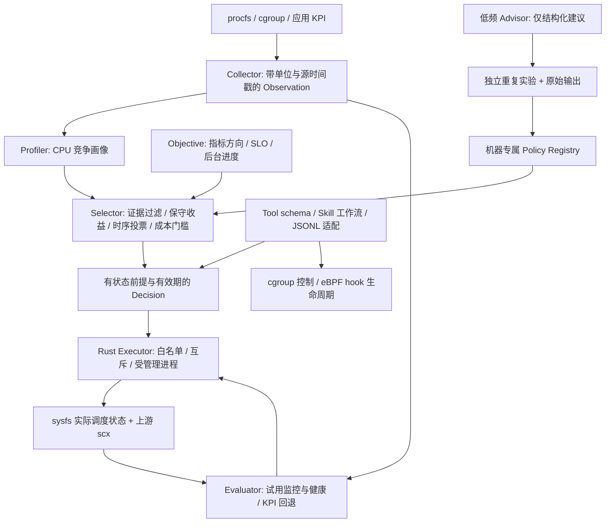

# ARMA4OS 框架设计

此实现依据 competition-plan.md，而非对两篇论文的端到端复现。Python 承担在线决策和低频分析，Rust 承担调度器执行；调度热路径仍由上游 scx/BPF 实现。在线过程无需 LLM、网络或模型服务。

## 数据与职责

- `contracts.py`：Observation、Metric、Objective、Constraint、Profile、Decision、ActionResult。单位、源、时间和缺失质量随数据传播，不将缺失替换为零。
- `collector.py`：CPU 累积计数转窗口比例，上下文切换转速率；CPU PSI avg10 为滚动压力指标，转换成 fraction；cgroup 计数明确保留累积单位。应用 KPI 由受信任采集器写入 JSON，原始时间戳不刷新。首个 CPU 观测没有差分，明确缺失。
- `profiler.py`：保守的规则画像，CPU 利用率与压力同时表明竞争才进入校准路由。当前不使用应用名、预置阶段标签或 benchmark 的未来时间表作为路由答案。
- `registry.py`：独立标定次数、机器、上下文范围、有效期、来源、均值与不确定区间。执行白名单在 Rust 配置中独立定义；证据不能扩展可执行命令。
- `selector.py`：过滤过期、样本不足、上下文不符和违反 SLO / 进度约束的成绩；同一策略有重叠上下文时拒绝择优取样。比较主指标的保守界，连续窗口和指数衰减投票支持同一候选后才切换。当前目标质量归一化为单位效用，以相对改善乘评价窗口得到效用积分，假设切换期间效用为零计入保守惩罚。对于延迟目标，它表示质量效用而不是节省的墙钟时间；这是待消融验证的显式代理模型。`switch_cost_s` 必须是涉及该专家的完整转换耗时上界，已含卸载和加载，匹配转换取两端上界的最大值，避免重复计费。
- `executor.py`：一个长期 Rust 子进程；请求 ID 关联、超时、通道故障和关闭处理。另有纯 Python 模拟器，供未构建 Rust 时验证控制流程。
- `evaluator.py` / `agent.py`：试用期核对 KPI、约束与实际策略，退化触发回滚；试用结束只表示未触发健康阈值，不写成策略因果改善。退出恢复默认策略并保存审计。
- `tools.py` / `skills.py`：传输无关的结构化原子能力与可执行工作流。CLI 与 Skill 使用相同 Agent 和 Executor，不另建一套控制面。
- `advisor.py`：可注入低频分析 provider；返回受限的策略建议，不能执行命令、生成 root shell 或直接更新证据。provider 必须支持自身网络 deadline。未内置任何供应商 SDK、凭据或自动远程调用。
- `hooks.py` / `bpf_hook.py`：统一 attach / detach / stats。CPU weight 操作只面向配置授权的 cgroup，保存原值并检测外部修改；可选 eBPF ingress hook 统计且始终放行。
- `calibration.py`：从原始实验重建汇总，拒绝失败组、样本不足、单位不符和缺少区间的成绩，生成需复核的策略库草案。上下文范围、目标映射和切换成本仍需独立测量并确认。

## 论文思想的落点

| 参考方法 | 本项目落点 | 当前界限 |
| --- | --- | --- |
| ASA 专家路由与机器标定 | Registry + Selector + scx 专家集合 | 没有作者训练数据或原始模型，不声称重现论文成绩 |
| ASA 时间概率稳定与冷却 | 衰减候选投票、连续窗口、冷却和最短驻留 | 第一版为规则画像；训练树模型留待可信数据 |
| SchedCP 观测 / 规划 / 执行 / 学习 | Collector / Selector / Rust Executor / 实验与 Registry | 四类逻辑职责，无需四个远程 LLM agent |
| SchedCP 工具化控制面 | ToolRegistry、Skill、JSONL 与 Advisor seam | 当前实现 CLI JSONL；MCP 网络接入可作为后续适配器 |
| 计划中的目标 / 成本约束 | 应用主指标、保守约束过滤、统一时间窗口成本代理 | 创新与收益仍需目标敏感性、成本敏感性、反馈消融实测 |

## 执行与权限边界

同一内核全局 scx 策略只有一个当前选择，scheduler mutation Tool 必须使用 global scope。cgroup 范围的应用目标可以参与决策，但不意味着为每个 cgroup 同时加载独立全局 scx 调度器。

真实后端使用固定本地配置直接 argv 启动程序。普通 Tool 请求只传 Decision ID；执行器再次核验有效期与期望策略，不接受请求中的任意二进制或 shell。状态核验以 sysfs 为准，进程存活不足以证明成功。仅终止自身管理的进程；遇到外部调度器拒绝接管。

当前传输是父子进程 stdio，部署者负责权限。它尚不是带身份验证的 root 守护服务，也不提供自动提权。不要给不受信任调用者执行 CLI、修改执行器配置或选择任意程序路径的权限。真实运行优先在专用测试机，由可信管理员启动；后续可以为同一执行协议实现 Unix socket 与服务端鉴权，收紧特权进程边界。

正常退出、EOF、可处理的信号与加载错误有清理路径。SIGKILL、断电和内核崩溃无法靠用户态 finally 保证恢复；内核 watchdog 和人工恢复仍是最后防线。部署时应保持所有执行器共享规范 state_dir，不并行运行其他 scx 控制器；跨不同目录的锁不能当作全局系统仲裁。
