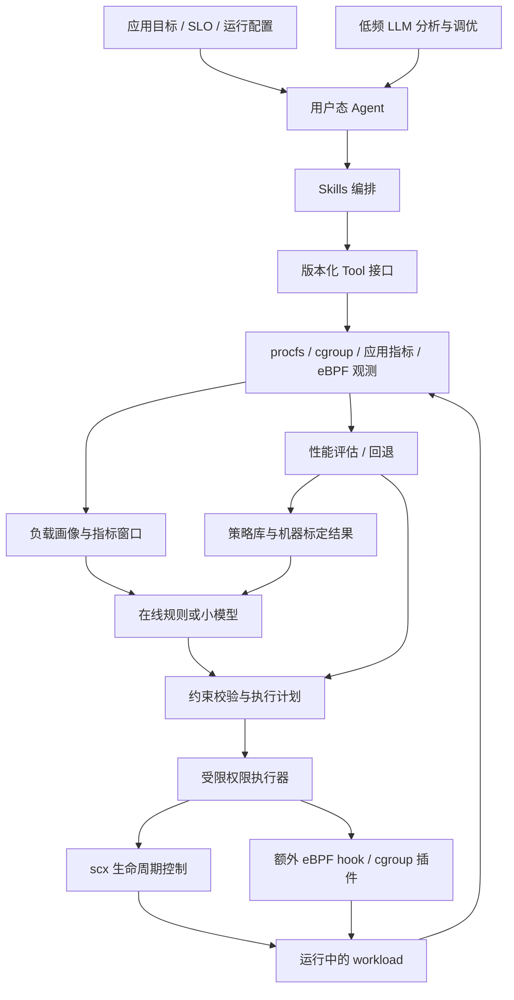

# ARMA4OS 赛题实施计划

制定日期：2026-10-18。范围依据：当前 README.md（含用户新补充的评分细则）、两篇参考论文、官方 scx / WSL 文档，以及本次对当前环境的只读检查。

团队约束：2 人、约 8 周、x86_64，优先在 WSL2 跑通，最终面向 openEuler。本文是实施计划，文中的性能目标和参数都是待实验验证的建议，不代表已经取得的结果。

## 1. 推荐路线

实现一个“双时间尺度、反馈驱动”的用户态资源管控 Agent：

- 在线层借鉴 ASA：根据系统指标识别负载，从预验证的专家调度器中选择策略，控制切换频率，并评估切换收益。
- 分析与调优层借鉴 SchedCP：通过标准 Tool / Skills 接口分析应用目标、检索策略、提出配置，并将实验结果写入策略库。
- 先用现有 scx 调度器完成闭环，再加入 LLM 分析和小范围参数调优。自生成 eBPF 调度器作为后续增强项。
- 交付重点是 openEuler 上可运行、可解释、可回退、可复现实验的系统；WSL2 是第一阶段开发与联调环境。

项目的核心论证应是：**在负载变化和前后台混合运行时，系统能依据应用性能目标选择策略，并以可控开销取得优于固定策略的实测收益。**

## 2. README 要求与验收对应

| README 要求 | 应实现的内容 | 可验收证据 |
| --- | --- | --- |
| 可扩展用户态 Agent 框架 | 观测、决策、执行、反馈分离；插件注册和版本化数据结构 | 同一框架运行 CPU 调度插件与一个额外 hook 示例 |
| 标准化 Tool / Skills | Tool 提供结构化原子能力；Skill 编排任务和验证流程 | 接口 schema、调用记录、失败处理、新增插件示例 |
| 感知 workload 状态和需求 | 系统 / cgroup 指标，加应用自身吞吐和延迟；明确优化目标 | 时间序列、负载画像、瓶颈判断和决策理由 |
| sched_ext / scx 调度闭环 | 真实加载、卸载、状态确认、切换、效果评估、回滚 | 内核活动调度器状态和日志，而非仅打印“已切换” |
| eBPF hook 扩展能力 | 通用 attach / detach / metrics 生命周期，明确权限与作用域 | 至少一个非调度类 eBPF hook 的实际运行演示 |
| 完整性能对比与复现 | 固定版本、场景矩阵、原始数据、重复实验和汇总脚本 | 从干净环境重建并重跑主结果的操作文档 |

上述表格是工程验收建议。README 已补充评分权重，但还没有指定 workload、固定内核、性能计分公式或提交格式；应在第 1 周核实这些限制。对于 network / security / cgroup，底座应具备扩展接口；演示一个 hook 不能被表述为已实现三类完整策略系统。

### 2.1 按评分细则配置工作量

| 评分项 | 分值 | 项目需要提供的证据 | 对排期的影响 |
| --- | --- | --- | --- |
| 创新性 | 30 | 明确的决策机制、与 ASA / SchedCP 的区别、针对该机制的消融实验 | 第 1 周确定假设，第 3-4 周实现，第 6 周验证；不能只在答辩中包装架构 |
| 功能完整性 | 25 | 感知、目标识别、策略选择、执行核验、性能反馈、失败恢复和插件接口 | 第 2 周闭环，第 4 周稳定；正确选择和正确保持都要展示 |
| 性能提升 | 25 | 相同目标内核上相对默认调度器的应用 KPI 改善，附重复实验及开销 | 第 1 周建立基线，第 3 周找有效场景，后续持续测量 |
| 代码质量 | 10 | 清楚的模块边界、配置与类型合同、关键状态机测试、注释和部署文档 | 从第一周执行，重点测试执行 / 恢复 / 指标计算，避免最后一周集中补质量 |
| 演示效果 | 10 | 可重放的负载变化、真实内核状态、决策依据、应用 KPI 和一次恢复 | 第 2 周起使用同一演示脚本，第 7-8 周完成交叉复现和预演 |

前三项占 80 分，应共同围绕 CPU 自适应主线展开。代码质量和演示贯穿开发；完整 network / security 产品、复杂 UI 和多 Agent 数量不应消耗主线预算。评分未公布阈值，不能将某个性能提升比例换算成预期得分。

### 2.2 主创新：目标与切换成本共同约束的路由

推荐实现一个项目自身的在线策略决策器，核心是：**同一负载特征在不同应用目标下可作出不同选择；即使存在更优候选，如果阶段过短、收益不足以覆盖切换成本，也保持当前策略。**

相对 ASA 的主要变化是从“分类 -> 机器映射”转为“负载上下文 + 应用目标 + 性能证据 + 切换成本 -> 受约束的策略选择”。ASA 已经讨论开销校准和冷却，因此“考虑开销”本身不能作为与 ASA 的创新区别；要证明的是应用目标改变时的决策能力，以及逐次动作的收益门槛和反馈恢复。

工程上将 SchedCP 式分析 / 调优放在低频路径，另设有明确周期、状态和时延预算的持续在线模块。这是本项目的具体组织方式，不代表 SchedCP 原框架无法支持在线优化。两者结合本身是架构组合；可验收的增量在于决策规则和证据，不能仅以“双层 Agent”名称主张创新。

最小实现步骤：

1. 明确三类目标：批处理完成时间、延迟服务 SLO、混部下的前台 SLO 与后台最低进度。
2. 离线在不同并发度和混部比例下标定候选性能，保存结果及不确定性。
3. 在线过滤不满足约束的候选，比较剩余候选的保守收益；证据不足时不切换。
4. 用实际加载 / 卸载开销和配置的最短有效驻留时间设置收益门槛，使收益和成本在同一评价时间窗口内比较；不能将毫秒开销直接减去 QPS 增益。
5. 对已执行策略持续观察，违反目标或健康约束时恢复，并记录失败条件。

不必先预测未知任务的剩余运行时间。固定的保守评价窗口和最短驻留时间更容易实现和验证；之后再研究阶段持续时间估计。

为这条创新预留三组实验：

- **目标敏感性**：同一混部输入，改变事先声明的前台 SLO / 后台约束，检查决策是否随目标合理变化，并报告双方 KPI。
- **成本敏感性**：相同负载阶段、不同阶段持续时间；与不计切换成本的路由比较切换次数和全程性能。
- **反馈有效性**：与只按映射执行、没有试用评估 / 回退的版本比较，测量退化持续时间与恢复效果。

这些机制在系统研究中可能已有先例；本项目需依据文献对照解释具体差异，不能未经检索宣称学术首创。若第 3 周验证成本门槛并无实际收益，应如实调整主张，而不是只保留有利图表。

## 3. 两篇论文分别怎么借鉴

### 3.1 ASA：在线识别与专家路由

《Mixture-of-Schedulers: An Adaptive Scheduling Agent as a Learned Router for Expert Policies》将 workload 识别与机器相关的调度器映射解耦：[S1]。

论文的主要机制：

1. 通过 eBPF、procfs，以及桌面环境信息采集特征。
2. 以 XGBoost 为主分类器，辅以 Random Forest / SVM，预测 workload 类型。
3. 使用带指数衰减的时间窗口概率投票稳定预测。
4. 查询目标机器的“场景 -> 最优调度器”映射，按需卸载旧调度器、加载新调度器，并设置冷却时间。
5. 离线准备包含原型学习、监控与切换开销校准、真实切换环境中的模型 / 映射优化三个阶段。

适合复用的思想是：专家策略集合、目标机器标定、时序平滑和冷却机制。两人项目可以先用规则，再训练单个小型树模型；无需先复刻集成分类器和桌面端 28 场景测试。

需要补足的部分：

- 识别“CPU 密集”不能直接得出“应该提高吞吐”；目标应来自 workload 配置、应用 SLO 或经确认的分析结果。
- 同一种负载在不同并发度、机器拓扑、混部比例下可能对应不同最优策略，映射不能只有应用名。
- 需要明确处理未知负载、低置信度、无收益切换和性能回退。
- 本次论文页面未提供可确认的 ASA 官方实现仓库入口；不能假定模型、训练数据或标定流水线可直接取得。

ASA 论文报告的 86.4% 场景胜率等数值属于作者的 VM / 桌面工作负载实验，不能作为本项目收益承诺。[S1]

### 3.2 SchedCP：控制面与工具体系

《Towards Agentic OS: An LLM Agent Framework for Linux Schedulers》把“优化什么”与“如何观测和执行”分开：[S2]。

- 控制面有 Workload Analysis Engine、Scheduler Policy Repository、Execution Verifier 三类服务，通过 MCP 暴露能力。
- sched-agent 用 Observation、Planning、Execution、Learning 四类角色组织分析和优化。
- 策略规划可以先配置现有调度器，再修改或生成调度器。
- 调度热路径运行编译后的策略；LLM 在控制面承担语义分析和策略构造。

公开仓库是 `eunomia-bpf/schedcp`，默认分支为 `master`。可研究复用的入口包括 `mcp/src/scheduler_manager.rs`、`system_monitor.rs`、`workload_profile.rs`、`scheduler/schedulers.json` 和 workload 脚本。[S3][S4]

**论文设计与公开代码的差异必须核实。** 论文描述了静态调度逻辑分析、micro-VM、签名部署 token 和熔断。当前读取的 `scheduler_generator.rs` 中，`verify_scheduler` 对应编译产物通过 sudo 启动 loader，默认运行 10 秒，再停止并检查错误输出；该路径不能证明具有完整隔离、无饥饿或性能保证。仓库 README 也明确标注 experimental。[S2][S3][S5]

因此建议按模块复用或借鉴，不把整个研究原型直接当成已完成的产品底座。第一版把四个角色作为逻辑阶段即可，不必运行四个独立 LLM Agent。

### 3.3 本项目的可验证贡献

| 层面 | 已有工作提供的基础 | 本项目优先验证的增量 |
| --- | --- | --- |
| 在线自适应 | ASA 的 workload 分类与专家映射 | 面向应用 SLO 的策略选择、切换成本与回退 |
| 控制面 | SchedCP 的工具化分析和执行 | 统一插件契约、权限收敛、完整运行证据 |
| 目标环境 | 论文中的特定硬件 / Linux 环境 | openEuler 适配和版本锁定的复现包 |
| 混合负载 | 多种专家调度器 | 前台尾延迟与后台进度约束的共同评价 |
| 扩展性 | eBPF / MCP 基础能力 | 同一插件生命周期接入额外 eBPF hook |

这些是项目贡献候选，不是已经证明的学术首创结论。

## 4. 当前环境与第一道技术关卡

### 4.1 已检查的事实

当前工具连接的环境如下；它不代表用户可能另行准备的 openEuler 环境：

| 项目 | 当前结果 |
| --- | --- |
| 用户空间 | `/etc/os-release`：Ubuntu 24.04.5 LTS |
| 内核 | `6.18.33.2-microsoft-standard-WSL2` |
| 架构 | x86_64 |
| CPU | AMD Ryzen 7 8745H；来宾可见 16 个逻辑 CPU |
| BTF | `/sys/kernel/btf/vmlinux` 存在 |
| BPF / cgroup | 配置中 BPF、BPF_SYSCALL、BPF_JIT、CGROUPS、CGROUP_BPF 已启用 |
| sched_ext | `/proc/config.gz` 明确为 `# CONFIG_SCHED_CLASS_EXT is not set`；`/sys/kernel/sched_ext` 不存在 |

**当前阻碍是运行内核未启用 sched_ext。升级用户态包、安装 openEuler rootfs 或仅更换发行版，不能自动改变这个内核配置。**

用户提到的“openEuler 24.04”需以实际 `/etc/os-release` 或镜像名称核实；官方有 24.03 LTS 系列，本次当前环境中的 24.04 属于 Ubuntu。不能把当前实验写成 openEuler 实验。[S12]

### 4.2 WSL2 跑通路径

1. 记录 Windows / WSL 版本、当前内核完整版本和配置；保留原内核的恢复路径。
2. 从匹配版本的 Microsoft WSL 内核源码及其配置出发，启用 `CONFIG_SCHED_CLASS_EXT`，核查 scx 所需的 BPF / BTF / JIT 选项；锁定源码提交。
3. 按 Microsoft 官方构建说明生成内核，按需准备匹配模块 / headers / perf；通过 Windows 用户目录的 `.wslconfig` 指定自定义内核。[S10][S11]
4. Windows 侧重启 WSL 后，核实运行的是新内核，`/sys/kernel/sched_ext/state` 可读。
5. 构建与该内核兼容的固定 scx 提交，只编译选定调度器；启动后读取实际状态，退出后确认回到默认调度器。
6. 跑一个短 schbench 和一次恢复测试，保存命令、版本与原始输出，作为 M0 验收。

上述是计划，本轮未编译内核、修改 `.wslconfig` 或加载调度器。WSL 内核变更可能影响同一 WSL2 VM 中的其他发行版，需要在实际操作前明确环境影响。普通 Docker 容器共享宿主内核，不能单靠容器镜像补上缺失的 sched_ext。

WSL 内核联调预算建议限定为 2-3 个工作日。若持续受构建、加载或 Windows 侧条件阻碍，改用独立 openEuler VM 继续主线，WSL 保留为编码环境。常规 VM 不依赖在 WSL 内开启嵌套虚拟化。

### 4.3 openEuler 验收路径

- 第 1 周确认赛事允许的 openEuler 版本、内核来源和是否可换内核；第 2 周就完成一次真实调度器加载。
- 若发行版原内核支持 sched_ext，优先沿用；若没有，选择赛事允许的支持内核 / backport。版本号不能代替配置和实际加载检查。
- 上游 sched_ext 自 Linux 6.12 起合入；厂商 backport 另行核实。scx 的 BPF 接口不保证跨内核稳定，必须锁定并实测“内核 + scx 提交 + 工具链”。[S6][S7]
- openEuler 用户空间 + Microsoft WSL 内核的结果，应明确标为这一组合，不能等同于原生 openEuler 内核结果。
- 最终优先提供独立 openEuler VM 或物理机结果。若条件只允许 WSL，完整披露环境，结论仅限定在该环境内。

## 5. 最小架构与实现边界

### 5.1 六个必须做实的模块

| 模块 | 第一版职责 | 刻意限制的复杂度 |
| --- | --- | --- |
| Collector | 约 1 秒采样，提供系统 / cgroup / 应用指标；按需追加 eBPF | 不先采集几十上百项特征 |
| Profiler | 聚合画像、识别负载阶段、绑定优化目标 | 不把 CPU 利用率当性能目标 |
| Policy Registry | 存调度器版本、参数范围、兼容性、标定成绩和适用条件 | 先用 JSON 配置和 SQLite / JSONL 记录 |
| Selector | 规则路由起步，再加入小型树模型；低置信度保守处理 | 不先训练深度 RL 或在线任意探索 |
| Executor | 排他执行、真实状态核验、超时、回退、审计 | 不暴露任意 root shell |
| Evaluator | 读取应用 KPI、判断约束、记录效果、触发回滚 | 不把一次前后变化直接认定为策略的因果收益 |

建议 Agent、工具层和实验脚本先采用 Python，scx 使用上游 Rust / BPF 实现；新增 eBPF probe 用 libbpf / CO-RE。若复用 SchedCP 的 Rust MCP 服务，只保留清楚的进程接口，不并行重写第二套控制面。主要原则是两人能调试和维护。

### 5.2 Tool / Skills 的最小合同

Tool 是有 schema 的原子能力，建议先定义：

- `system.capabilities`：内核能力、架构、可用插件及约束。
- `metrics.snapshot`：指标、时间范围、单位、来源、缺失和采样质量。
- `workload.profile`：目标 workload / cgroup、负载画像和应用目标。
- `scheduler.list` / `scheduler.status`：可用策略和实际活动状态。
- `scheduler.plan` / `scheduler.apply` / `scheduler.rollback`：候选计划、执行和恢复。
- `experiment.run` / `experiment.result`：运行已注册测试、查询结构化成绩。
- `hook.attach` / `hook.detach` / `hook.stats`：额外 eBPF hook 生命周期。

统一字段至少包括 `schema_version`、`request_id`、目标作用域、超时、参数校验、结构化结果 / 错误、审计记录。会改变状态的操作应支持预检查和幂等语义。`apply` 应校验计划有效期及当前状态，防止基于过期观测执行。

Skill 是对这些工具的工作流编排，例如 `latency_optimization`、`batch_optimization`、`mixed_workload_tuning`。明确输入、前置能力、调用流程、成功标准、失败恢复和版本；它不应只是一个未经验证的提示词文本。

MCP 是外部接入适配层：先让 CLI / 本地 Agent 用同一工具合同跑通，再暴露 MCP，可减少协议问题与调度问题相互干扰。

### 5.3 权限和恢复

- 普通 Agent / LLM 只提出结构化计划；执行器接受白名单策略 ID 和限定范围的参数。
- 执行器只管理自身拥有的调度器进程和已授权 cgroup；发现外部控制器占用时报告冲突。
- 切换顺序是检查、保存状态、停止旧策略、确认卸载、启动新策略、核验活动状态、观察效果。
- 新策略无法加载时，恢复最后可用策略；无法恢复时确认回到内核默认公平调度类，并记录失败。
- Executor 的健康检查和恢复逻辑应独立于 LLM。LLM 超时、无网络或返回非法配置时，在线闭环继续工作。
- 内核自身 watchdog / SysRq-S 是最后一道恢复机制，无法替代应用性能监控；eBPF verifier 通过也不代表公平、无饥饿或性能更好。[S7]

### 5.4 全局调度与 cgroup 作用域

同一内核上的 scx 选择会影响其接管范围内的任务，不能假定每个应用可同时独立加载一个不同的全局 scx 调度器。普通全量模式会接管正常公平类任务；partial 模式需要调度器支持并显式选择任务，不宜直接作为第一版隔离承诺。[S7]

前后台差异化策略可在第 5 周研究 `scx_layered`，用一个调度器按任务 / cgroup 分层；参数修改是否支持在线生效，要按锁定版本确认，不支持时应计入重载成本。[S8]

不能假设所有 scx 参数都能通过写 map 在线修改。本次核查 `scx_bpfland` 时，BPF 端的 `slice_max` / `slice_min` 为 `const volatile`，Rust 端在加载前写入 `rodata`。要实现运行时调整，需要选择已有明确运行时接口的字段，或自行增加受限 control map、验证更新一致性和参数边界；这属于额外改造，不是现成能力。[S14]

## 6. 在线决策怎么做

### 6.1 从可观测和可解释的版本起步

第一批输入控制在约 10-15 项：CPU user / system / idle、CPU pressure、运行队列或可用的等待统计、上下文切换、迁移、cgroup CPU 使用和 throttling、应用 P99 / 吞吐、后台进度。eBPF 唤醒等待直方图在需要时增加；PMU / perf 事件在 WSL 不可用时应明确降级。

第一版规则策略：

1. 没有明显 CPU 调度瓶颈、观测不足或没有可信候选收益：保持当前策略或默认策略。
2. 延迟型 workload：优先满足 P99 / SLO，再在满足约束的候选中选择吞吐更优者。
3. 批处理：以完成时间 / 有效吞吐为主，不以“占满 CPU”为成功。
4. 混合负载：优先保证前台 SLO，同时限制后台吞吐回退或保证最低进度。

专家集合从“内核默认 + scx_bpfland + scx_rusty”开始；若其中一个无法在目标组合工作，用已验证可用的候选替换。`scx_bpfland` 强调交互负载优先，`scx_rusty` 提供可调度域 / 负载均衡；它们的实际优劣必须由本机实验决定。[S9][S13]

### 6.2 防止抖动和错误优化

- 初始采样周期建议 1 秒、聚合窗口 5-10 秒；连续多个窗口支持同一候选才切换。
- 冷却时间先从 15-30 秒试验，之后根据阶段长度和实际加载成本标定。
- 只有预测收益超过监控、决策、卸载 / 加载及短期扰动成本时才执行。
- 试用期观测吞吐、尾延迟和错误率；违反预定义阈值时恢复。阈值需根据噪声和 SLO 标定。
- 不把阶段变化时自然改善 / 恶化直接记为策略收益；策略库成绩主要由可重放的对照实验更新。
- “低置信度保持当前策略”和“性能异常恢复默认策略”是不同情况，应分别记录。

第 4 周若规则已能稳定工作，再用标定数据训练决策树 / XGBoost。按独立运行、负载配置和时间段划分训练 / 测试集；相邻窗口不能随机分到两边。对未知并发度和混部比例保留测试，模型只有在实际策略效果优于规则时才成为默认。

## 7. 两人八周安排

建议 A 主要负责内核 / scx / 执行器，B 主要负责指标 / Agent / 实验；工具合同和里程碑双方共同验收。

| 周次 | A：系统与执行 | B：Agent 与实验 | 当周验收 |
| --- | --- | --- | --- |
| 第 1 周 | WSL 自定义内核、scx 加载与恢复；确认 openEuler 内核路径 | 固定 schbench / 批处理测试，定义 KPI、schema 和数据目录；确定创新假设 | M0：真实加载一个调度器，跑一次测试并恢复；有默认基线及创新实验定义 |
| 第 2 周 | 执行器状态机、两个专家策略；openEuler 上加载验证 | Collector、应用指标、实验 runner、规则 Selector；首次静态 A/B | M1：观测 -> 决策 -> 切换 -> 反馈完整闭环；两环境能力表及首次静态差异 |
| 第 3 周 | 参数白名单、并发互斥、异常恢复和重启清理；测切换成本 | 静态标定矩阵、独立重复、目标约束与收益门槛的首版 | M2：已知至少一个有收益场景、一个保持默认更合适的场景；主创新可运行 |
| 第 4 周 | 验证 Agent 中断和加载失败恢复；完善动作 / 状态证据 | 时序平滑、成本门槛、目标变化与阶段长度实验；小模型视数据决定 | M3：负载和目标改变后合理响应；有计入 / 不计成本的对照 |
| 第 5 周 | 研究 layered 混部配置；完成额外 eBPF hook 示例 | Skills / MCP 接入、低频 LLM 分析、策略经验存储 | M4：统一接口驱动多个能力，LLM 断开仍可运行 |
| 第 6 周 | openEuler 部署包 / systemd 或 CLI 启停；长时间运行检查 | 冻结策略与测试集，执行主要实验及主创新的三组消融 | M5：openEuler 主结果、创新验证、原始数据和复现配置齐备 |
| 第 7 周 | 修复实验暴露的问题；另一人从干净环境复现 | 统计汇总、负结果、限制、技术报告和演示脚本 | M6：交叉复现成功，报告结论与数据一致 |
| 第 8 周 | 版本冻结、安装恢复演练、交付检查 | 答辩材料、录屏、复现包、演示预演 | 最终交付；只修阻断问题，保留缓冲 |

关键依赖：内核能力 -> 实际加载 -> 可靠执行器 -> 静态标定 -> 在线选择 -> 动态收益 -> openEuler 主实验。指标和实验 runner 从第一周并行推进。openEuler 兼容性不得推迟到最后两周。

时间预算建议约为：前两周跑通环境和闭环，中间三周完成选择 / 恢复 / 扩展，后三周主要用于实验、交叉复现与交付。

## 8. 实验设计

### 8.1 控制场景数量

| 场景 | 建议配置 | 主要指标 | 要回答的问题 |
| --- | --- | --- | --- |
| 调度微基准 | schbench，低 / 中 / 高并发 | 唤醒 P50 / P95 / P99，吞吐 | 调度策略是否产生可测差异 |
| 批处理 | 固定源码、配置和并行度的干净编译，或固定压缩任务 | 完成时间、有效吞吐 | 真实任务是否变快 |
| 前后台混部 | Redis + 固定 CPU 后台任务；必要时先用 schbench + 后台负载 | 前台 P99 / QPS，后台进度或完成时间 | 是否只是牺牲后台换取前台收益 |
| 阶段变化 | 固定时刻改变并发度 / 加入后台 / 停止后台，重放同一脚本 | 响应时间、切换次数、SLO 违约时间、全程性能 | 自适应是否优于一个固定策略 |

CPU 调度效果以应用指标为最终依据。I/O 或内存完全主导的场景可以作为“不切换”对照，不应强行承诺 CPU 调度带来收益。

### 8.2 必须包含的对照

1. 内核默认调度器，Agent 关闭。
2. 每一个静态专家调度器，固定配置，Agent 关闭。
3. 只监控、不施加动作的 Agent，用于量化观测开销。
4. 完整自适应 Agent。
5. 从独立标定集选出的“最佳固定策略”，在相同未见动态序列上测试。

主创新的目标敏感性、成本敏感性和反馈有效性对照属于必做实验；有余力再做规则与学习路由对照，以及去掉时序平滑的消融。事后按测试结果挑出的静态最佳策略可作为事后参考；按每阶段挑最佳组成的动态 oracle 只是理想参考，必须说明是否忽略切换成本。

### 8.3 测量纪律

- 默认策略、静态专家和 Agent 必须运行在同一目标内核与同等资源配置下，避免把换内核的收益算成 Agent 收益。
- 固定 kernel / scx / 工具链 / workload 提交，记录 vCPU、内存、SMT、拓扑、频率策略、亲和性、cgroup、后台任务。
- WSL 主测试使用 Linux 文件系统中的数据目录，避免 Windows 挂载目录的文件系统开销混入结论。
- 各调度器试验串行进行，顺序随机化或交错轮换。WSL 的多个发行版不作为独立隔离的并行调度试验场。
- 首轮每配置至少 5 次独立运行；根据噪声决定是否增至 10 次以上。先预热，明确缓存 / 冷启动策略。
- 从每次独立运行生成统计，报告区间和原始点；不要把同一次运行的一秒窗口当作独立重复。
- 尾延迟需要足够样本、固定测量窗口，并报告请求量、输入负载和错误数。固定到达率测试需正确记录排队和超时，避免漏计拥塞造成的延迟。
- 若客户端与服务同机，固定客户端资源和测量方式，并说明其干扰；能使用外部负载发生器时优先使用。
- Agent 的采样、推理、执行和 eBPF 开销分别测量；性能成绩包含真实切换时间，不能删掉不利过渡段。
- 显式报告无改善和回退场景，不只展示最佳数字。

建议结果结构：`results/<environment>/<run_id>/` 下保存 manifest、原始应用输出、metrics、决策与动作日志、summary；summary 可从原始数据重新计算。

延迟降幅使用 `(baseline - agent) / baseline`，吞吐增幅使用 `(agent - baseline) / baseline`；完成时间加速比使用 `baseline_time / agent_time`。不同量纲分别报告，不能将原始 P99 与 QPS 直接求平均。

### 8.4 内部验收目标

以下是立项时可用的目标，需要第 3 周结合真实噪声调整，不是赛题硬指标或收益承诺：

- 至少一个真实 workload 的应用 KPI 改善超过测量噪声；可把 5%-10% 作为探索目标。
- 混部场景预定义前台 SLO 和后台最低进度，报告两者，而非只提升其中一项。
- 动态场景相对默认策略有明确收益，并与独立选出的最佳固定策略比较。
- 不值得切换时能保持当前 / 默认策略；失败加载或异常能恢复且有日志。
- 报告额外 CPU、RSS、决策耗时、实际加载耗时和端到端阶段响应时间，分别设预算。
- 至少 2 小时固定脚本运行中没有未恢复的调度器故障；恢复演练有可重复记录。

功能准确性另行检查：受约束目标是否满足、已执行计划是否与内核实际状态一致、未知负载是否保守处理、失败是否恢复。分类准确率可作为诊断指标，但不能替代策略效果；事后评测参考存在统计并列时，也不应强行标成“选择错误”。

## 9. 第 5 周的最小扩展示例

建议先实现一个 cgroup 范围内的非调度 eBPF hook，例如通过 `cgroup_skb` 统计测试服务的入 / 出字节和包数，始终允许流量通过；同时用资源控制 Tool 对授权 cgroup 的 `cpu.weight` 做受限调整并支持恢复。

它验证两件事：eBPF hook 可以提供系统侧观测，同一 Agent / Tool 合同可以驱动 scx 之外的资源控制。网络观测不等于网络策略执行；若赛题要求实际 network policy，需再添加有明确范围、默认允许和回滚机制的实验策略。security policy 在八周内优先保留接口与设计，除非官方要求必须演示。

扩展之前必须完成 CPU 主线，且主要对比实验要单独固定或关闭扩展动作，避免无法区分 scx 收益与 cgroup 调参收益。

## 10. 范围取舍与停止条件

必须完成：目标环境能力检查、真实 scx 闭环、Tool / Skills 合同、应用 KPI、可靠恢复、可运行 hook 示例、静态 / 动态对照、openEuler 复现包。

依据新增评分，必须完成项再加：项目自身的目标 / 成本约束决策机制及相应消融。单纯复现 ASA 或封装 SchedCP，难以充分支撑 30 分创新性这一项。

优先增强：小型学习路由、低频 LLM 分析 / 配置建议、layered 混部优化、有限参数搜索。LLM 若在正式题目中被明确要求，应将这条低频路径提升为必须完成。

最后再做：从零生成调度器、完整多 Agent 系统、在线 RL、多资源联合优化、复杂可视化平台、大规模跨硬件迁移。

停止 / 降级规则：

- WSL 内核超过 2-3 个工作日仍无法加载：切独立 VM 推进。
- 第 3 周静态专家均无显著差异：先复查 CPU 争用、基准和拓扑，并增加一种适合的负载；暂缓模型训练。
- 小模型未优于规则：交付规则为默认，保留学习结果和原因。
- 第 5 周 layered 适配代价过大：交付已验证的全局路由，报告混部限制。
- 第 6 周仍未完成 openEuler 主实验：冻结新能力，集中完成目标平台闭环和证据。

## 11. 最终交付与答辩演示

交付内容：源码与依赖锁定、能力检查脚本、WSL / openEuler 两套环境说明、CLI / 服务启停方法、Tool schema 与 Skill 示例、策略库、原始实验数据、汇总脚本、性能报告、限制和恢复说明。

建议 5-8 分钟演示顺序：

1. 显示 openEuler 环境、内核能力、当前真实调度器和应用目标。
2. 启动固定混部 workload，展示默认策略成绩。
3. 启用 Agent，展示画像、候选理由、实际切换和 KPI。
4. 重放负载阶段变化，观察保持 / 切换 / 回退。
5. 演示一次失败恢复，以及同一接口下的额外 eBPF hook。
6. 展示独立重复实验汇总与复现入口。

第 2 周起固定一个简洁的 CLI 状态视图，显示时间、应用目标、观测窗口、实际调度器、决策理由、动作结果和应用 KPI；第 4 周让它随阶段变化刷新。它与完整审计日志使用同一数据来源，不用动画或预置成绩替代实际执行证据。复杂网页看板不进入八周核心范围。

最近三步：A 准备匹配 WSL 内核配置与加载方案；B 先完成默认调度器下的固定基准和原始数据格式；双方确认真实 openEuler 版本和赛事允许的内核范围。这三件事完成后，再定第 2-4 周的具体策略与阈值。

## 12. 来源与证据范围

- [S1] ASA 论文全文，v1，第 3-5 节：<https://arxiv.org/html/2511.11628v1>。
- [S2] SchedCP 论文全文，v4，第 3-5 节：<https://arxiv.org/html/2509.01245v4>。
- [S3] SchedCP 官方 README：<https://github.com/eunomia-bpf/schedcp/blob/master/README.md>。
- [S4] SchedCP 工程结构文档：<https://github.com/eunomia-bpf/schedcp/blob/master/document/PROJECT_STRUCTURE.md>。
- [S5] SchedCP 调度器生成 / 验证源码：<https://github.com/eunomia-bpf/schedcp/blob/master/mcp/src/scheduler_generator.rs>。
- [S6] scx 官方 README，内核 / 工具链 / 安装说明：<https://github.com/sched-ext/scx>。
- [S7] Linux 官方 sched_ext 文档，全局 / partial 接管、故障恢复与 ABI 不稳定性：<https://docs.kernel.org/scheduler/sched-ext.html>。
- [S8] scx_layered：<https://github.com/sched-ext/scx/blob/main/scheds/rust/scx_layered/README.md>。
- [S9] scx_bpfland：<https://github.com/sched-ext/scx/blob/main/scheds/rust/scx_bpfland/README.md>。
- [S10] Microsoft WSL 内核构建说明，6.18 分支：<https://github.com/microsoft/WSL2-Linux-Kernel/blob/linux-msft-wsl-6.18.y/README.md>。
- [S11] Microsoft `.wslconfig` 文档，自定义 kernel / kernelModules / processors / memory：<https://learn.microsoft.com/en-us/windows/wsl/wsl-config>。
- [S12] openEuler 官方下载与版本信息：<https://www.openeuler.org/zh/download/>。
- [S13] scx_rusty：<https://github.com/sched-ext/scx/blob/main/scheds/rust/scx_rusty/README.md>。
- [S14] scx_bpfland 的 BPF 参数和加载流程：<https://github.com/sched-ext/scx/blob/main/scheds/rust/scx_bpfland/src/bpf/main.bpf.c>、<https://github.com/sched-ext/scx/blob/main/scheds/rust/scx_bpfland/src/main.rs>。

当前环境事实来自本轮实际执行的 `uname -a`、`cat /etc/os-release`、`lscpu`、`ls -l /sys/kernel/sched_ext /sys/kernel/btf/vmlinux /proc/config.gz /boot`、`cat /sys/kernel/sched_ext/state`，以及对 `/proc/config.gz` 的 `zgrep`。所有网页 / master / main 分支引用均为本轮读取的状态；实施时应进一步锁定提交，不假设文档与代码永远一致。

本轮仅进行需求分析、资料核对和计划编写，未运行性能实验，未完成 ASA / SchedCP 端到端复现。README 中的微信公众号链接未作为技术结论依据；这里的论文判断直接来自全文及作者公开仓库。

